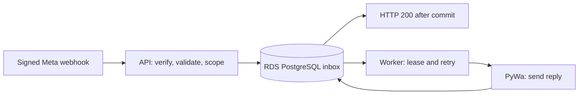

# Architecture

Univio is a modular Python application with two process types, sharing one image:
an HTTP API and a reply worker. Conversation navigation remains stateless. RDS
PostgreSQL stores a durable inbox, not a user-profile database. The original
project remains unchanged and its database/AI/document features are not imported.

## Boundaries

- `app.py`: HTTP, authentication, payload bounds, composition, liveness/readiness.
- `config.py`: explicit required settings and verified production database TLS.
- `events.py`: strict validation of the fields used from Meta envelopes.
- `conversation.py`: pure navigation decisions, shared messages and button labels.
- `delivery.py`: PyWa reply construction and development-process duplicate cache.
- `inbox.py`: PostgreSQL transactions, uniqueness, leases, retries and retention.
- `worker.py`: background execution, provider-error classification and shutdown.
- `migrate.py` and `migrations/`: explicit, serialized, checksummed schema changes.
- `runtime.py` and `__main__.py`: bounded server entry point and Windows-compatible
  event-loop setup without import-time global policy changes.

No generic service framework or ORM is required for the inbox.
Psycopg parameterized SQL expresses the transaction/locking behavior directly.
DRY applies to message copy, navigation options and shared image-publish logic.
New domain features should get their own tested boundaries when required, not
speculative layers now. Repository rules are in [skills.md](../skills.md).

## Acceptance and delivery guarantees

With `DATABASE_URL`, the API validates the whole webhook before atomically
inserting eligible events. A unique SHA-256 key derived from phone ID plus Meta
message ID suppresses concurrent/replayed inserts. Acknowledgement means the
transaction committed, **not** that a reply was delivered. Status notifications,
unrelated phone numbers, future-dated and at least 23-hour-old events are ignored.

Workers use `FOR UPDATE SKIP LOCKED` to claim a row, increment attempts and assign
a 60-second lease with a fresh token. Sends have a 15-second deadline. Expired
leases can be reclaimed; completion updates must match the lease token, so a
stale worker cannot overwrite a newer database claim. Multiple worker processes
can operate without sharing in-memory state. No strict per-recipient ordering
is promised; current menus do not depend on ordering or hidden sessions.

HTTP/transport timeouts, 429, provider throttling and server failures retry with
bounded exponential delay, at most five claims. Explicit non-throttling 4xx
provider errors are terminal. Exhausted/expired jobs become `dead`; counts are
available from the protected delivery-status endpoint. Recipient information is
cleared immediately after sent/dead outcomes. A dead job cannot be replayed once
its recipient is removed: investigate the category, fix the cause and have the
user send a new message. There is no silent indefinite retry loop.

This is at-least-once processing, not exactly-once delivery. A process may crash
after Meta accepted a send but before the completion transaction. A paused
worker might resume after its lease expired. PostgreSQL fencing cannot revoke a
send already in flight at Meta. A duplicate reply is still possible at that
external-system boundary; claiming otherwise would be incorrect.

## Privacy, retention and capacity

The inbox stores event key, scoped phone ID, recipient, timestamp, allowlisted
command/kind, processing metadata and a temporary media ID for uploads.
Optional document intake stores file bytes in private S3 quarantine and receipts
in RDS. Raw webhook bodies, free text, form answers and profiles are excluded.
See the [applicant journey](applicant-journey.md) for the scan, deletion and AWS
release gates. Pending work expires after 23 hours; terminal
tombstones retain duplicate protection for eight days. Workers run retention
maintenance every minute. If all workers stop, retention pauses too: alert on
worker absence and queue age, and include backup retention in the privacy policy.

Each API/worker pool has at most five PostgreSQL connections. Budget total task
counts against the RDS connection limit. Webhook bodies are bounded to 1 MiB,
20 messages per request, ten seconds to read, and server concurrency is capped
at 100. Protect the public boundary with edge request-rate controls; a database
inbox alone is not protection against traffic floods.

## Modes

`APP_ENV=production` requires PostgreSQL and an existing CA file; the driver
overrides DSN TLS settings with `verify-full` and checks the RDS hostname.
Use this mode in staging as well. Migrations never run automatically on API or
worker startup. Readiness verifies the expected inbox columns exist.

Without a database, only `development` mode may send replies inline. That mode
retains its bounded, process-local cache for laptop/testing convenience and has
no durability guarantees. Production cannot silently fall back to it.

## Deployment boundary

PR CI runs lint, formatting, unit and real PostgreSQL integration tests plus the
existing security checks. Dev/main publishing uses an environment-scoped shared
workflow to build, scan and push an immutable commit-tagged ECR image. It does
not deploy ECS or run migrations. Enable protected environments and required PR
checks; use a distinct production OIDC role and registry scope.

AWS resources, verified RDS connectivity, ECS rollouts, rollback, backup restore,
load tests and alarms still require environment setup and validation. Follow the
[production runbook](production.md); passing Python tests alone is not a live
production readiness certification.

References: [AWS PostgreSQL TLS](https://docs.aws.amazon.com/AmazonRDS/latest/UserGuide/PostgreSQL.Concepts.General.SSL.html),
[Psycopg connection pools](https://www.psycopg.org/psycopg3/docs/advanced/pool.html),
[PyWa client](https://pywa.readthedocs.io/en/latest/content/client/overview.html).
